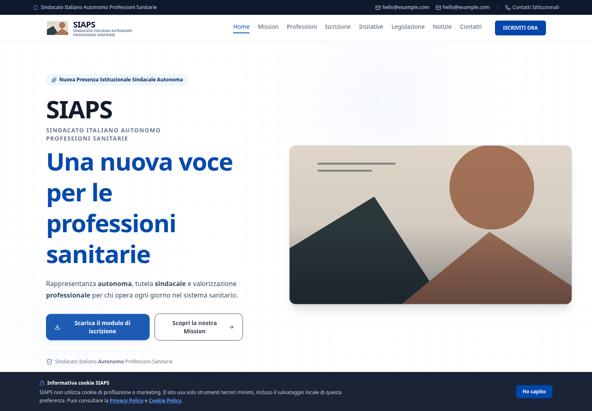

# SIAPS — Association Website

I built the SIAPS website around its mission, professional groups, news, membership information and contact pages.

[Live project](https://siaps.it) · Public portfolio edition



## Stack and features

React, TypeScript, Vite, Motion and Tailwind CSS.

- Reusable sections, cards and responsive navigation
- Membership download flow using a local example document
- Client-side page navigation and accessible form layouts

## Run locally

Use Node.js 22 and npm:

```bash
npm ci
npm run dev
```

Open `http://localhost:3000/`. No account, service keys or environment configuration are required. Use fictional data when exploring forms.

## Public edition

The membership form is replaced with a plain-text example. Images and contacts are placeholders. Contact delivery, Supabase download tracking and the production statistics API are not included.

This repository starts from a separate source snapshot and contains no production Git history, hosting configuration, backups or operational reports. Public content and page structure are retained where useful; demo assets and sample contacts replace client materials. The live project runs from its separate private repository.

## Checks

```bash
npm run build
npm run lint
```

The CI workflow runs the build and TypeScript checks. Dependency update requests are configured through Dependabot. Production services are outside the scope of these checks.

## Assets

The SVG illustrations in this edition are simple geometric examples supplied with the source. Client artwork, photographs, membership documents and CV PDFs are not distributed. Third-party font licences are kept alongside the font files where used.
